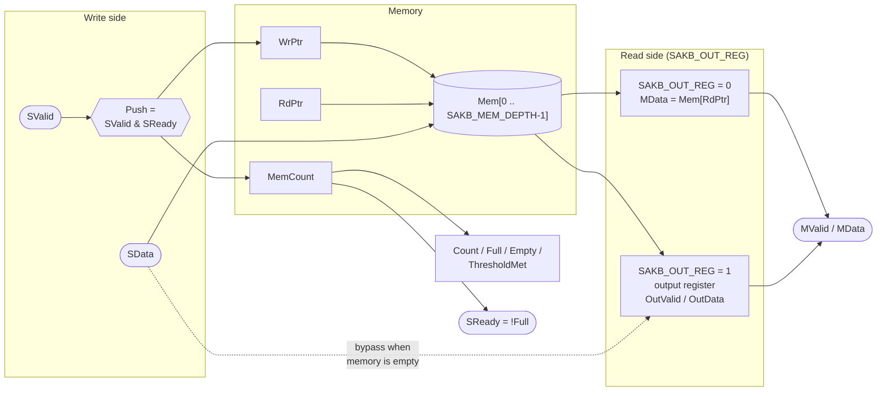
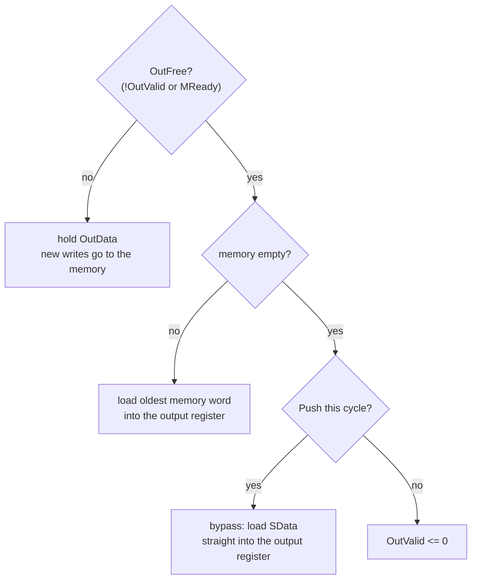

# Synchronous FIFO (SystemVerilog)

A parameterized, single-clock FIFO with **valid/ready handshakes** on both
sides, a selectable **read mode** (first-word fall-through or registered
output), and a programmable **threshold flag**. It comes with a
self-checking testbench, an SVA assertion checker, and a one-command
simulation flow for **Icarus Verilog** and **Verilator**.

---

## Features

- Valid/ready (AXI-Stream style) handshake on the write and read sides
- Any `SAKB_DEPTH >= 2`, power of two or not
- Two read modes, chosen with the `SAKB_OUT_REG` parameter:
  - `0` – first-word fall-through, data comes straight from the memory
  - `1` – registered output, `MValid`/`MData` come straight from flip-flops
- Status outputs: `Count`, `Full`, `Empty`, `ThresholdMet`
- Synchronous active-low reset
- Fully synthesizable RTL: no `initial` blocks or simulation-only code
- No combinational path from any input to any output
- SVA checker attached with `bind`, so the RTL holds no verification code

---

## Repository layout

```
.
├── rtl/
│   └── SyncFifo.sv         FIFO design
├── sva/
│   ├── SyncFifoSva.sv      assertion checker and parameter checks
│   └── SyncFifoBind.sv     attaches the checker to every SyncFifo instance
├── tb/
│   └── TbSyncFifo.sv       self-checking testbench with a reference model
├── Makefile
└── README.md
```

### Naming convention

| Item                              | Style                         | Example                         |
|-----------------------------------|-------------------------------|---------------------------------|
| Modules, files                    | PascalCase                    | `SyncFifo`, `SyncFifoSva.sv`    |
| Ports, signals, tasks, labels     | PascalCase                    | `SValid`, `WrPtr`, `ThresholdMet` |
| Parameters and local parameters   | `SAKB_` + UPPER_CASE          | `SAKB_DEPTH`, `SAKB_MEM_DEPTH`  |

---

## Interface

### Parameters

| Parameter        | Default            | Description                                                  |
|------------------|--------------------|--------------------------------------------------------------|
| `SAKB_DATA_W`    | `8`                | Width of each data word                                      |
| `SAKB_DEPTH`     | `16`               | Number of words the FIFO holds (any value `>= 2`)            |
| `SAKB_THRESHOLD` | `SAKB_DEPTH*3/4`   | `ThresholdMet` is high when `Count >= SAKB_THRESHOLD` (`1..SAKB_DEPTH`) |
| `SAKB_OUT_REG`   | `0`                | `0` = first-word fall-through, `1` = registered output       |

Illegal parameter values stop the simulation at time 0 with a `$fatal`
message. That check lives in `SyncFifoSva`, so the RTL stays synthesizable.

### Ports

| Port           | Dir | Width                   | Description                         |
|----------------|-----|-------------------------|-------------------------------------|
| `Clk`          | in  | 1                       | Clock                               |
| `RstN`         | in  | 1                       | Synchronous reset, active low       |
| `SValid`       | in  | 1                       | Write data is valid                 |
| `SReady`       | out | 1                       | FIFO can take a word (`!Full`)      |
| `SData`        | in  | `SAKB_DATA_W`           | Write data                          |
| `MValid`       | out | 1                       | Read data is valid (`!Empty`)       |
| `MReady`       | in  | 1                       | Reader takes the word               |
| `MData`        | out | `SAKB_DATA_W`           | Read data (oldest word in the FIFO) |
| `Count`        | out | `$clog2(SAKB_DEPTH+1)`  | Number of stored words, `0..SAKB_DEPTH` |
| `Full`         | out | 1                       | `Count == SAKB_DEPTH`               |
| `Empty`        | out | 1                       | `Count == 0`                        |
| `ThresholdMet` | out | 1                       | `Count >= SAKB_THRESHOLD`           |

A word is written on a rising edge when `SValid && SReady`, and read on a
rising edge when `MValid && MReady`.

---

## Architecture

### Block diagram



### Memory and pointers

Data lives in a memory of `SAKB_MEM_DEPTH` words, written at `WrPtr` and
read at `RdPtr`. Both pointers jump back to `0` after the last slot, which is
what lets `SAKB_DEPTH` be any value rather than only a power of two. A
separate counter (`MemCount`) drives the full and empty decisions, so the
pointers do not need an extra "wrap" bit.

The memory has no reset. Only the pointers, the counter and the valid bit are
reset, which keeps the memory mappable to RAM.

### Read mode `SAKB_OUT_REG = 0` – first-word fall-through

`SAKB_MEM_DEPTH = SAKB_DEPTH`. The word at `RdPtr` is always on `MData`, and
`MValid` is high whenever the FIFO is not empty. This is the smallest
version, but the memory's read multiplexer sits on the output path.

### Read mode `SAKB_OUT_REG = 1` – registered output

`SAKB_MEM_DEPTH = SAKB_DEPTH - 1`, and the last slot is an output register,
so the total capacity is still `SAKB_DEPTH`. `MValid` and `MData` come
directly from flip-flops, which keeps the read multiplexer away from
whatever logic follows the FIFO.

The output register is refilled whenever it is empty or being read
(`OutFree = !OutValid || MReady`):



Because of the bypass, whenever the memory holds data the output register is
also full. So a write shows up on `MValid` one cycle later in **both**
modes, and `Full` always equals `!SReady`.

### Flags and the threshold

`Count` is the total number of stored words, including the output register in
mode `1`. All flags are simple compares on `Count`:

```
Full         = (Count == SAKB_DEPTH)
Empty        = (Count == 0)
ThresholdMet = (Count >= SAKB_THRESHOLD)
```

Example with `SAKB_DEPTH = 10`, `SAKB_THRESHOLD = 7`. `ThresholdMet` goes
high once 3 or fewer free slots are left
(`SAKB_DEPTH - Count <= SAKB_DEPTH - SAKB_THRESHOLD`):

| Count         | 0 | 1–6 | 7 | 8 | 9 | 10 |
|---------------|---|-----|---|---|---|----|
| free slots    |10 | 9–4 | 3 | 2 | 1 | 0  |
| Empty         | 1 | 0   | 0 | 0 | 0 | 0  |
| ThresholdMet  | 0 | 0   | 1 | 1 | 1 | 1  |
| Full          | 0 | 0   | 0 | 0 | 0 | 1  |

### Design choices

- **`SReady` does not look at `MReady`.** A write is refused while the FIFO
  is full, even if a read happens in the same cycle. This keeps the write
  side free of any combinational path from the read side, which matters when
  FIFOs are chained.
- **A counter instead of comparing pointers.** It works for any depth, and it
  gives `Count` and `ThresholdMet` for free.
- **Synchronous active-low reset**, the usual FPGA style.

---

## Verification

### Testbench (`tb/TbSyncFifo.sv`)

A SystemVerilog queue is the reference model. Every clock cycle the
testbench:

1. compares `Count`, `Full`, `Empty`, `ThresholdMet`, `SReady` and `MValid`
   with the model,
2. drives new inputs on the falling edge (so it never races the DUT),
3. compares every word read from the FIFO with the model.

The write side follows the valid/ready rule: once `SValid` is raised it stays
high, with the same data, until the word is accepted.

| Phase | What it checks                                                         |
|-------|------------------------------------------------------------------------|
| 1     | Fill to full, then an extra write that must be refused                 |
| 2     | Drain to empty                                                         |
| 3     | Read and write in the same cycle at a steady fill level                |
| 4     | Random traffic: balanced, write-heavy, read-heavy, full-speed streaming |
| 5     | Reset while the FIFO holds data, then more random traffic              |

The test also fails if `Full`, a rising `ThresholdMet`, or a cycle with a
read and a write together never happened.

### Assertions (`sva/SyncFifoSva.sv`)

The checker only uses the FIFO ports, so it works in both read modes. It is
attached with `bind`, so the RTL itself holds no verification code. It also
holds the parameter range checks.

| Property                                       | Checks                                                  |
|------------------------------------------------|---------------------------------------------------------|
| `AssertResetEmpty`                             | FIFO is empty one cycle after reset                     |
| `AssertCountRange`                             | `Count` never goes past `SAKB_DEPTH`                    |
| `AssertFullFlag`, `AssertEmptyFlag`, `AssertThresholdFlag` | the flags match `Count`                     |
| `AssertNotFullAndEmpty`                        | `Full` and `Empty` are never high together              |
| `AssertReadyIsNotFull`, `AssertValidIsNotEmpty` | the handshake outputs match the flags                  |
| `AssertThresholdRise`                          | `ThresholdMet` rises exactly when `Count` reaches `SAKB_THRESHOLD` |
| `AssertCountUpdate`                            | `Count` changes by exactly writes minus reads each cycle |
| `AssertNoPushWhenFull`, `AssertNoPopWhenEmpty` | no transfers in impossible states                       |
| `AssertMValidHold`, `AssertMDataHold`          | an offered word stays put until it is read              |

Cover properties record reaching `Full`, `ThresholdMet` rising, leaving
`Full`, back-pressure on the read side, and a read and write in the same
cycle.

Icarus Verilog has limited support for concurrent SVA and `bind`, so the
assertions run under **Verilator**. The Icarus flow still runs the full
testbench check.

### Regression

`make regress` runs these configurations on both simulators:

| DEPTH | THRESHOLD | OUT_REG | Why                                   |
|-------|-----------|---------|---------------------------------------|
| 16    | 12        | 0, 1    | default, power of two                 |
| 10    | 7         | 0, 1    | depth that is not a power of two      |
| 2     | 1 / 2     | 0 / 1   | smallest legal depth                  |
| 7     | 7         | 0       | threshold equal to the depth          |
| 5     | 1         | 1       | threshold at its minimum              |
| 64    | 48        | 0, 1    | larger depth                          |

---

## Running the simulation

Requirements: [Icarus Verilog](https://github.com/steveicarus/iverilog) 12+
and/or [Verilator](https://github.com/verilator/verilator) 5.0+.

```bash
make                 # default config on both simulators
make iverilog        # Icarus Verilog only
make verilator       # Verilator with assertions enabled
make lint            # Verilator -Wall lint of the RTL and the checker
make regress         # every configuration on both simulators
make waves           # writes SyncFifo.vcd, open it with GTKWave
make clean
```

The Makefile variables `DATA_W`, `DEPTH`, `THRESHOLD`, `OUT_REG` and
`RANDOM_CYCLES` set the matching `SAKB_*` parameters:

```bash
make verilator DEPTH=10 THRESHOLD=7 OUT_REG=1
```

A passing run ends with:

```
------------------------------------------------------------
 writes=2386 reads=2371 full-cycles=739 threshold-rises=19 same-cycle=1623
 TEST PASSED
------------------------------------------------------------
```

(Reads are lower than writes because phase 5 resets the FIFO while it still
holds data.)

---

## Using the FIFO

```systemverilog
SyncFifo #(
  .SAKB_DATA_W    (32),
  .SAKB_DEPTH     (10),
  .SAKB_THRESHOLD (7),
  .SAKB_OUT_REG   (1'b1)
) FifoInst (
  .Clk          (Clk),
  .RstN         (RstN),
  .SValid       (InValid),
  .SReady       (InReady),
  .SData        (InData),
  .MValid       (OutValid),
  .MReady       (OutReady),
  .MData        (OutData),
  .Count        (FifoCount),
  .Full         (FifoFull),
  .Empty        (FifoEmpty),
  .ThresholdMet (FifoAlmostFull)
);
```
